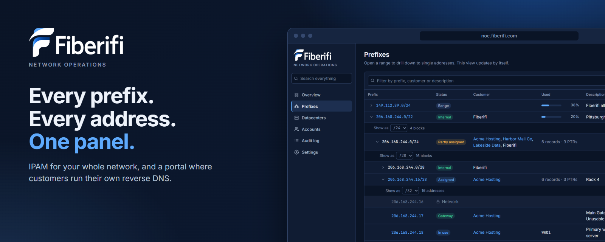
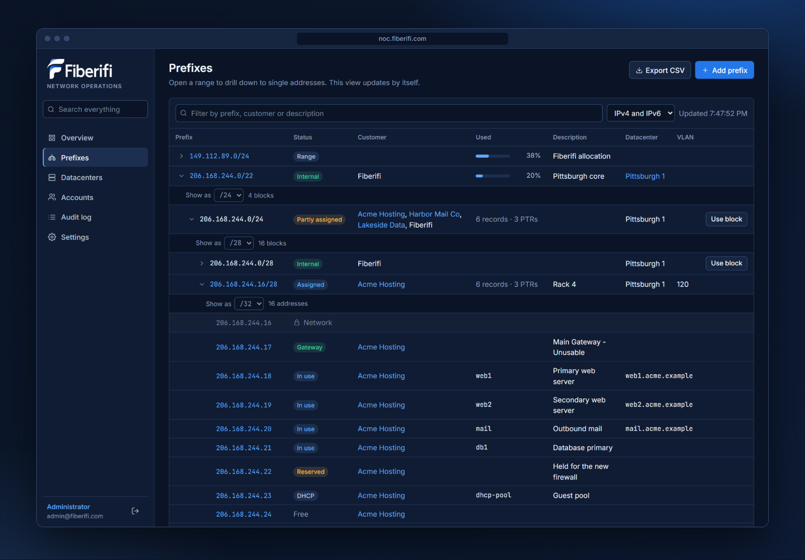
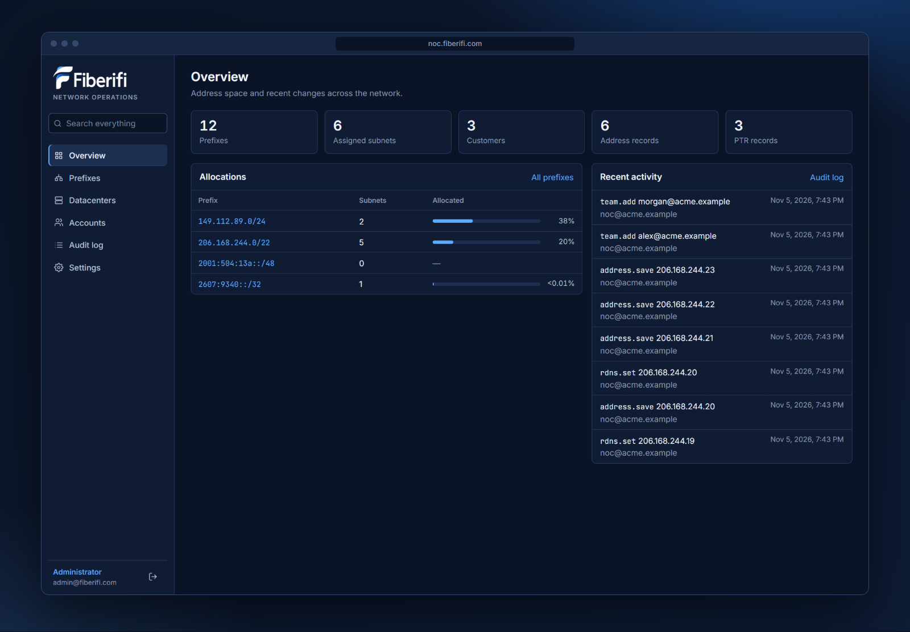
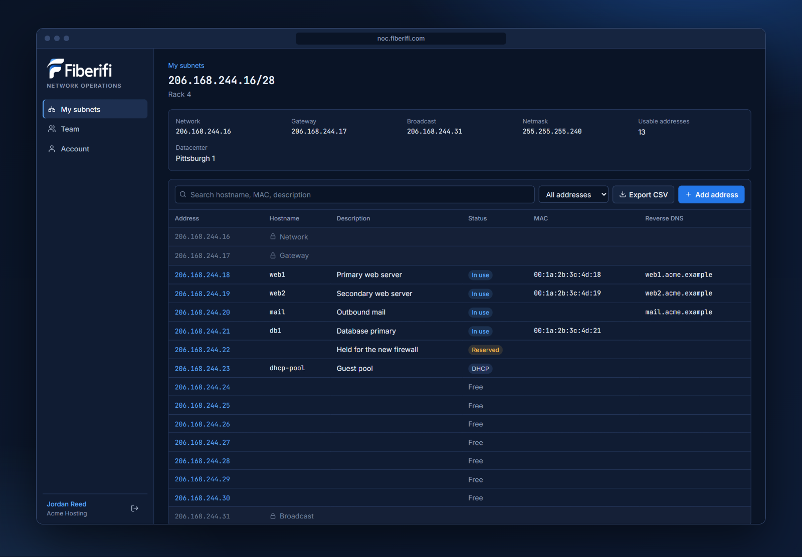
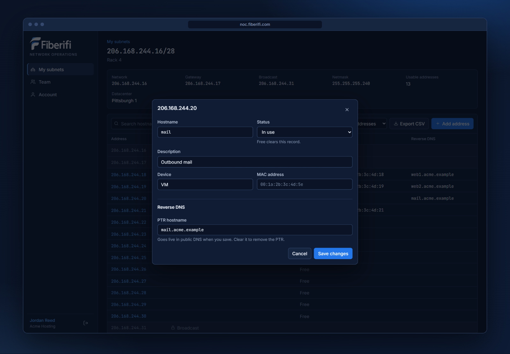
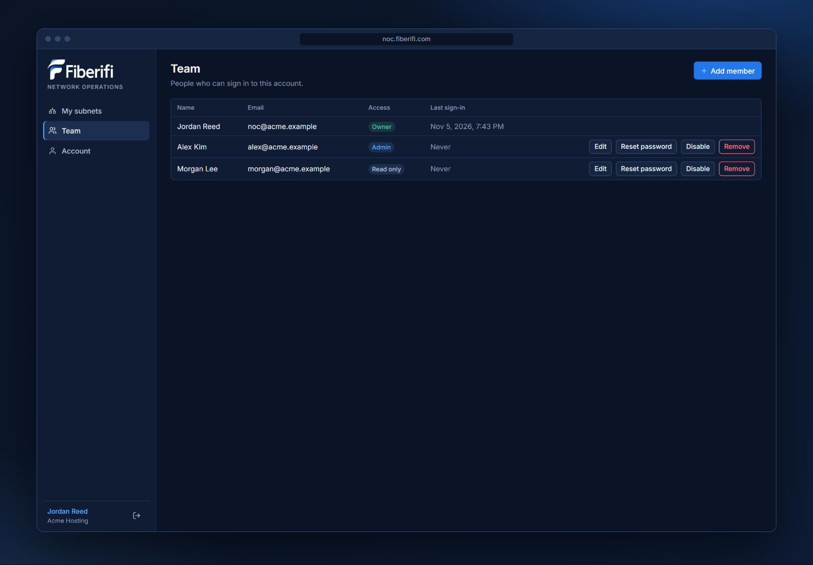
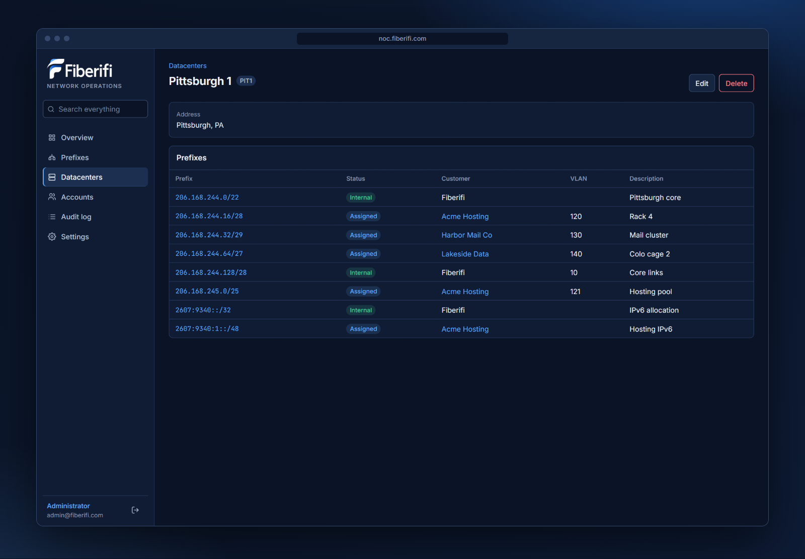
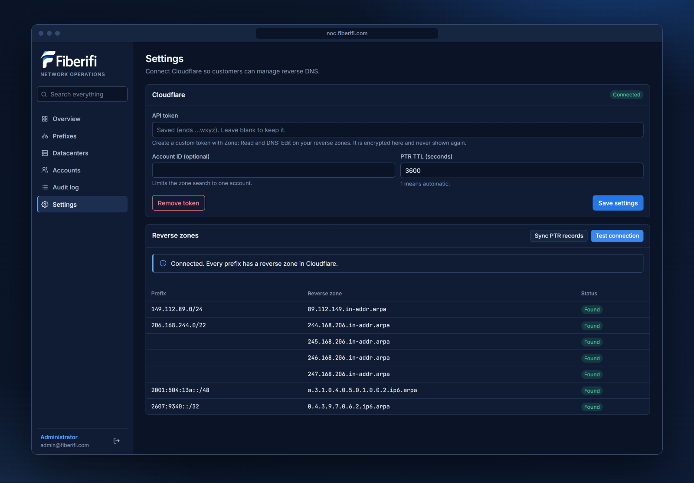
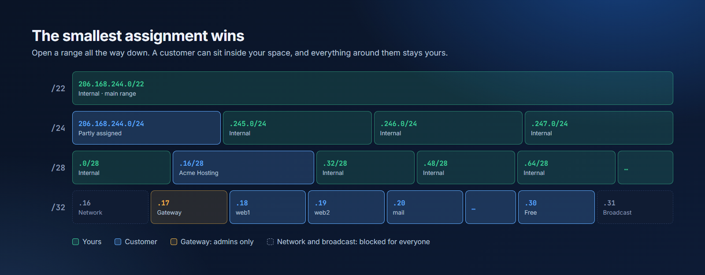
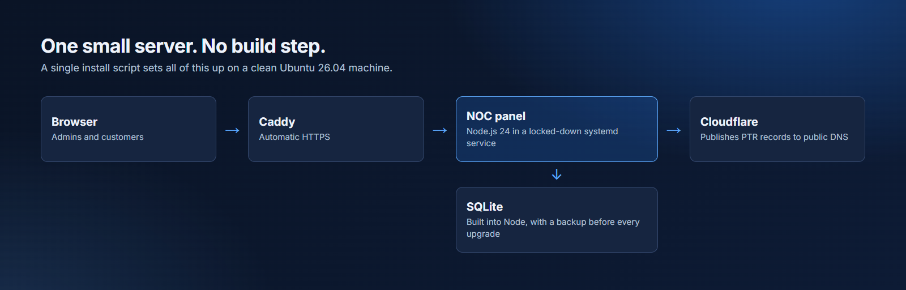

<p align="center">
  
</p>

<p align="center">
  
  
  
  
</p>

<h3 align="center">The network operations panel behind <a href="https://noc.fiberifi.com">noc.fiberifi.com</a></h3>

<p align="center">
  Fiberifi NOC is IPAM and a customer portal in one. Admins see every prefix down to a single address.<br>
  Customers manage their own subnets, teams and reverse DNS, without opening a ticket.
</p>

<p align="center">
  <a href="#install-on-ubuntu-2604"><b>Install</b></a> ·
  <a href="#see-it-in-action"><b>Screenshots</b></a> ·
  <a href="#connect-cloudflare"><b>Connect Cloudflare</b></a> ·
  <a href="#security"><b>Security</b></a>
</p>

---

## Why it's different

| | |
|---|---|
| 🔎 **Drill all the way down** | Open a `/22` into `/24`s, then smaller blocks, then single addresses. Blocks don't need to exist first, and assignments update live. |
| 🧩 **Nest prefixes freely** | Keep a whole range as your own and place customers inside it. The smallest assignment wins, and an address can never belong to two customers. |
| 📡 **Live router monitoring** | CPU, memory, bandwidth on every port and tunnel, and BGP sessions with a disconnect log, over encrypted SNMPv3. |
| 🌐 **Self-service reverse DNS** | Customers publish their own PTR records, straight to Cloudflare, only for addresses they own. |
| 👥 **Customer teams** | Each customer can add their own Admin and Read only logins. |
| 🔒 **Safe by default** | Gateway and broadcast addresses are worked out for every prefix and protected on the server, not just greyed out in the browser. |
| ⚡ **One command to install** | A single script sets up a clean Ubuntu server, with HTTPS included. No build step and no separate database server. |

## See it in action

### Drill down to any address

Start at your main range and open it level by level, with live assignments at every step. Turn any free block into a subnet with one click.



### See the whole network at a glance

Allocation across every range, and everything that changed recently.



### Give customers their own portal

Customers see only their own subnets. They keep records for each address, with the network, gateway and broadcast locked for them.



### Reverse DNS without a ticket

One dialog for an address's record and its PTR. Saving publishes straight to public DNS, and a PTR is always optional.



<table>
  <tr>
    <td width="50%"><b>Customer teams</b><br>Admin and Read only logins, managed by the customer.<br><br></td>
    <td width="50%"><b>Datacenters</b><br>See what's deployed where.<br><br></td>
  </tr>
</table>

### Know your DNS is ready

Test the Cloudflare connection and see which reverse zones are in place for every range.



*Screenshots use invented customers.*

## How ownership works



Every prefix automatically gets a gateway on its first usable address and a broadcast on its last. When prefixes nest, the smallest one decides what an address is.

## What's included

**For your team**

- Add, edit, split, nest and delete prefixes, for IPv4 and IPv6
- Allocate the next free block, or type the exact subnet you want
- Mark space as Internal, or assign it to a customer
- Address records with hostname, status, device, MAC and notes
- Live router status, port bandwidth and history graphs over SNMPv3
- Datacenters, VLANs, and search across everything
- CSV export, and a full audit log of every sign-in and change

**For your customers**

- Their assigned subnets, with gateway, broadcast and usable addresses
- Records for their own space
- Reverse DNS on any usable address
- Their own team logins, with Admin or Read only access

## Security

- **Scoped on the server.** Every request is checked against the account's own subnets. Another customer's subnet looks identical to one that doesn't exist.
- **Passwords** are hashed with scrypt, and first sign-in forces a new one.
- **Sessions** use `__Host-` HttpOnly, Secure, SameSite=Strict cookies, with a second cross-site check on every write.
- **The Cloudflare token and SNMP passwords** are encrypted with AES-256-GCM and never sent back to the browser.
- **Sign-in and DNS changes** are rate limited.
- **A strict Content Security Policy** allows no third-party scripts, styles or fonts.
- **The service** runs as an unprivileged user in a systemd sandbox, and can only write to its own data folder.

## Under the hood



## Install on Ubuntu 26.04

Tested on a clean Ubuntu 26.04.1 LTS system.

**1. Point DNS at the server.** Create `A` and `AAAA` records for `noc.fiberifi.com`, and make sure ports 80 and 443 are reachable. The TLS certificate is issued automatically once this is done. If your DNS is in Cloudflare, set these records to **DNS only**, because proxying them causes a redirect loop.

**2. Download and install on the server.**

```sh
sudo apt-get update && sudo apt-get install -y git
git clone https://github.com/theaustinayers/Fiberifi-NOC.git
cd Fiberifi-NOC
sudo bash deploy/install.sh
```

It installs Node.js 24 and Caddy, creates a locked-down `noc` service account, and starts everything. At the end it prints the first admin password, once. To use different values:

```sh
sudo DOMAIN=noc.fiberifi.com ADMIN_EMAIL=you@fiberifi.com bash deploy/install.sh
```

**3. Sign in, set a new password, and connect Cloudflare** (next section).

## Connect Cloudflare

Customers' rDNS changes are written to your reverse zones through the Cloudflare API.

1. In Cloudflare, add a zone for each reverse range you want to manage:

   | Range | Zone |
   |---|---|
   | `149.112.89.0/24` | `89.112.149.in-addr.arpa` |
   | `206.168.244.0/22` | `244.168.206.in-addr.arpa`, `245.…`, `246.…`, `247.…` (four zones) |
   | `2607:9340::/32` | `0.4.3.9.7.0.6.2.ip6.arpa` |
   | `2001:504:13a::/48` | `a.3.1.0.4.0.5.0.1.0.0.2.ip6.arpa` |

   The parent registry (ARIN) must delegate each zone to Cloudflare's nameservers, or the records will exist but nobody will see them.

2. Create an API token with **Zone: Read** and **DNS: Edit** on those zones.
3. In the panel, open **Settings**, paste the token and save.
4. Choose **Test connection** to see which zones were found.
5. Choose **Sync PTR records** to import any PTR records that already exist.

The token is encrypted in the database and never sent back to the browser.

## How it behaves

- **Reserved addresses.** Every prefix automatically has a network address, a gateway on the first usable address, and a broadcast on the last. Network and broadcast are blocked for everyone, in the API as well as the UI. Admins can edit the gateway's row and move it from the prefix's Edit dialog, and customers see it locked. IPv6 has no broadcast.
- **Gateways.** Every gateway shows as Main Gateway - Unusable with a green status, with nothing to enter. An admin's own description replaces that text on the row.
- **Which prefix decides.** When prefixes nest, the smallest one decides what an address is, so a `/22`'s gateway can't take a usable address from a `/31` inside it. Anything nested inside a customer's subnet is a label and reserves nothing.
- **Drilling down.** The Prefixes page opens any range into smaller blocks, down to single addresses, and refreshes every 15 seconds. Blocks don't need to exist as prefixes. **Use block** turns one into a real prefix and can assign it.
- **Internal space.** Choose **Internal (Fiberifi)** instead of a customer for space you use yourselves. **Release** removes the mark and keeps its records and PTRs.
- **Address status.** An address is Free until it has a record or a PTR. In use, Reserved and DHCP can be saved with nothing else filled in, and a PTR is always optional. Choosing Free clears the record and leaves any PTR alone.
- **Choosing a subnet.** Allocate takes the next free block of the length you pick, or the exact subnet you type, such as `206.168.244.240/29`. The **Allocate** button on a free-space row fills in that block.
- **Whole prefixes.** Allocating a prefix at its own size, such as `/22` from a `/22`, uses the whole prefix instead of subdividing it.
- **Nesting.** Prefixes can sit inside each other, and the smallest assignment wins: a customer can have a block inside an Internal range, and everything around it stays yours. An address can only belong to one customer, and a customer can't be given a block that contains a smaller Internal one. A prefix nested inside a customer's subnet is a label only, and doesn't reserve any of their addresses.
- **PTR records.** Customers can only publish them on usable addresses. Admins can also publish one on a gateway. Nobody can on a network or broadcast address, though admins can clear one that a sync imported.
- **Deleting a customer account** removes every PTR the account or its team created from Cloudflare. If any removal fails, the account is kept so nothing is left behind, and you can try again. Removing a single team member keeps their PTRs on the account.
- **`/31`, `/127` and `/32`.** Point-to-point subnets have no network or broadcast address. A single address has no gateway.
- **IPv6.** There is no broadcast, and the first address is treated as the network address. Because these subnets are enormous, only addresses with records are listed. Use **Add address** to create one.
- **Unassigning a subnet** removes the customer's access first, then deletes their address records and PTRs so the next customer inherits nothing. If Cloudflare is unreachable, the access is still removed and the admin is told which PTRs are left over. They can be cleared from the prefix's Addresses tab.
- **Default ranges** are seeded once. A deleted range stays deleted.
- **Team members.** A customer's owner login and any team member with Admin access can add logins to the account from the Team page. Admin members can edit records and rDNS and manage the team. Read-only members can view and export. Disabling or deleting a customer also cuts off its team.
- **Routers.** Polled over SNMPv3 from the NOC server every 30 seconds, for admins only. A router's page goes live while it's open: its interfaces, CPU and memory update every second, and BGP sessions every 6. SNMP agents refresh interface counters every 3 seconds, so bandwidth figures change at that pace. A router shows as Down after two failed polls. Detailed history is kept for 2 days and five-minute averages for 35 days. For a router behind a tunnel, use its tunnel IP as the SNMP address.
- **BGP sessions.** Read from the router's BGP4 MIB, which covers IPv4 peers. Click a session for its stats and a log of disconnects and reconnects, kept for 90 days. The log starts when monitoring starts. A session that drops and recovers between two readings shows as Dropped and recovered.
- **Router changes.** Compares subnet gateways with one router's interface over the VyOS API, under Routers. When a customer or Internal subnet in the chosen datacenter is created or deleted, a box offers to apply the change straight away, and **Not now** leaves it in the queue there. Nothing reaches the router until an admin applies it with their password. Deleting a change from the queue stops it being offered, and it can be restored. It only touches IPv4 addresses on that interface, never removes an address it has no prefix for, and never touches main ranges. A subnet at the start of a main range can share that range's IP, such as a `/27` beside a `/22`. VyOS API keys have full access to the router, so create a dedicated key and restrict `service https allow-client` to the NOC server.
- **Datacenters.** Managed under Datacenters in the menu. Allocating a subnet requires one, and VLAN is optional. A datacenter cannot be deleted while prefixes use it.

## Operations

| Task | Command |
|---|---|
| Upgrade | `git pull`, then `sudo bash deploy/install.sh` from the same folder. Data and settings are kept, and the database is backed up to `/var/lib/noc-fiberifi/backups/` first. |
| Logs | `journalctl -u noc-fiberifi -f` |
| Restart | `sudo systemctl restart noc-fiberifi` |
| Locked out of admin | `sudo noc-reset-admin admin@fiberifi.com` |

**Back up both of these:**

- `/var/lib/noc-fiberifi/` holds the database.
- `/etc/noc-fiberifi.env` holds `APP_SECRET`. Without it, the Cloudflare token cannot be decrypted and must be entered again.

For a consistent copy while the panel is running, stop the service first or use `sqlite3 noc.db ".backup backup.db"`.

## Development

```sh
npm install
npm run dev    # http://localhost:3100, prints the first admin password
npm test
```

The tests run against a mock Cloudflare API in `test/mock-cloudflare.js`. Set `CLOUDFLARE_API_BASE` to point the app at a different API endpoint.

## Not included yet

Two-factor sign-in, password resets by email, CSV import, bulk rDNS and scheduled backups.

---

<p align="center">Built by <a href="https://fiberifi.com">Fiberifi</a>.</p>
